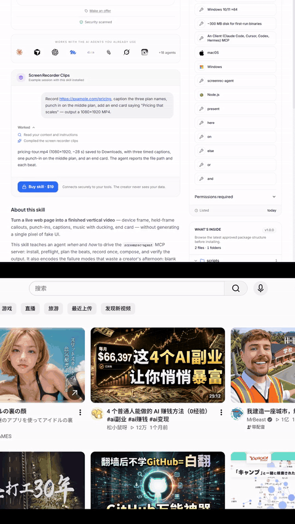
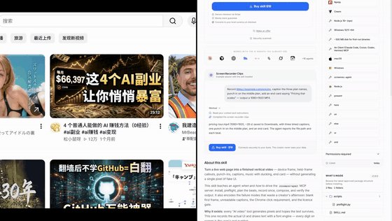

# Screen Recorder MCP

**Let your AI agent record a real browser page and cut it into a publishable vertical video.**

**By xukunAI** · an MCP server for Claude Code, Cursor, Codex and Hermes. Your agent records a page over CDP (no browser
extension, no permission dialog), then composes the clip: device frame, held-frame callouts, punch-ins,
captions, music with real ducking, end card.

Everything runs locally. No upload, no API key, no cloud render.

## Two recordings, one canvas

`split` puts a second recording next to the first — **stacked in 9:16, side by side in 16:9**,
with `ratio` and `gap` to tune it. The direction follows the canvas, so the agent never has to
choose. Captions, callouts, end card and music still apply in the same call.




```json
{ "target": "vertical",
  "split": { "source": "C:/rec/second.webm", "ratio": 0.5, "gap": 6 },
  "captions": [{ "start": 0.8, "end": 5.0, "text": "before / after" }] }
```

Full guides: **[English](docs/USAGE.md)** · **[中文](docs/USAGE.zh.md)**


```
录制 → 设备框 → 冻结圈注 → 局部放大 → 字幕 → 结尾卡 → 成片
```

## Why this exists

Every "AI video" tool generates pixels and hopes the text survives. This one doesn't generate anything:
it records your actual UI and draws text with a font engine. **Every digit is your real number.**

The agent-facing part is the point: an agent can produce a finished clip as a tool call, not a chat
suggestion.

## Tools

| Tool | What it does |
|---|---|
| `recorder_status` | recording state, bytes, bridge status |
| `recorder_start` | start recording a tab (Chrome requires one human click — see below) |
| `recorder_stop` | stop and save to Downloads |
| `recorder_files` | list recent recordings |
| `compose_clip` | the actual product: record → finished video |

`compose_clip` takes `captions`, `annotations` (held-frame callouts), `focus` (punch-ins), `end_title`,
`music`, `frame` (phone/browser), `pip` (picture-in-picture), `split` (second recording on the same canvas).

## Install

**npx (recommended)** — works in Claude Code, Cursor, Codex, Hermes and any MCP client:

```json
{
  "mcpServers": {
    "screen-recorder": {
      "command": "npx",
      "args": ["-y", "screenrec-agent"]
    }
  }
}
```

Then verify the install:

```
npx -y screenrec-agent --selftest
```

First run downloads the agent (~33 MB) and a pinned ffmpeg build (~201 MB) into
`%LOCALAPPDATA%\screenrec-agent\bin`. The cache is reused afterwards, and upgrading the launcher
re-downloads only the agent — ffmpeg is not fetched again. Downloads resume and retry on a dropped
connection instead of failing silently.

**Or use the exe directly.** Download `screenrec-agent.exe` from the
[latest release](https://github.com/Robert0303-C/screenrec-agent/releases/latest), put `ffmpeg.exe`
beside it (only `compose_clip` needs ffmpeg), and point `command` at the exe.

Published in the official MCP Registry as `io.github.Robert0303-C/screenrec-agent`.

## Pricing

| | Free | Full — $39 once |
|---|---|---|
| `recorder_*` — record with your agent | unlimited, forever | unlimited |
| `compose_clip` — turn a recording into a finished clip | **24 hours / 5 clips** | unlimited |
| Runs locally, nothing uploaded | yes | yes |

The trial starts on your first **successful** compose, not on install. When it ends, `compose_clip`
returns `license_required` with a purchase link — recording keeps working, nothing is deleted, nothing
crashes. Check what is left with `screenrec-agent --status`, unlock with
`screenrec-agent --activate <KEY>`.

**The only network call is activation itself.** Trial state lives on your machine (three copies, clock
rollback detection) because the alternative is a server that watches you use it. Deleting all three
copies is equivalent to a fresh install — offline software cannot prevent that, and we would rather be
honest about it than ship surveillance.

Buy: https://www.creem.io/product/prod_57FG0V8N2N4z3PrCzK0Klr  ·  xukun.online

## The one gesture Chrome insists on

`chrome.tabCapture` needs `activeTab`, and `activeTab` only comes from invoking the extension on that tab.
No script can fake it (verified: even a trusted CDP click inside an extension page fails). So:

- **Page recording** (CDP) — fully autonomous, no click, no extension
- **Desktop + microphone recording** (extension) — the human clicks the toolbar icon once, the agent
  handles everything after

## Requirements

- Windows 10/11 x64
- ~300 MB disk
- An MCP client

## Roadmap

- [x] CDP recording, freeze-frame callouts, punch-ins
- [x] Device frame, captions, end card, music ducking, picture-in-picture
- [ ] Voice-over (piper, EN + ZH) — Full edition
- [ ] macOS

## License

Commercial. Source available for review; redistribution of the packaged binary is not permitted.
